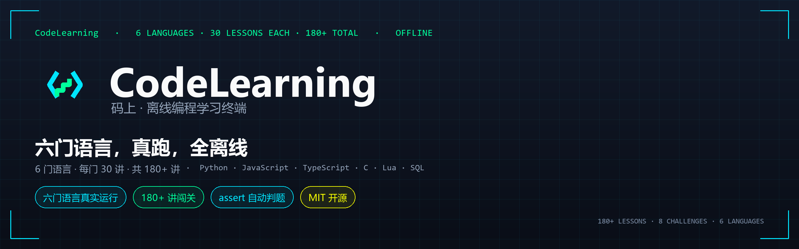
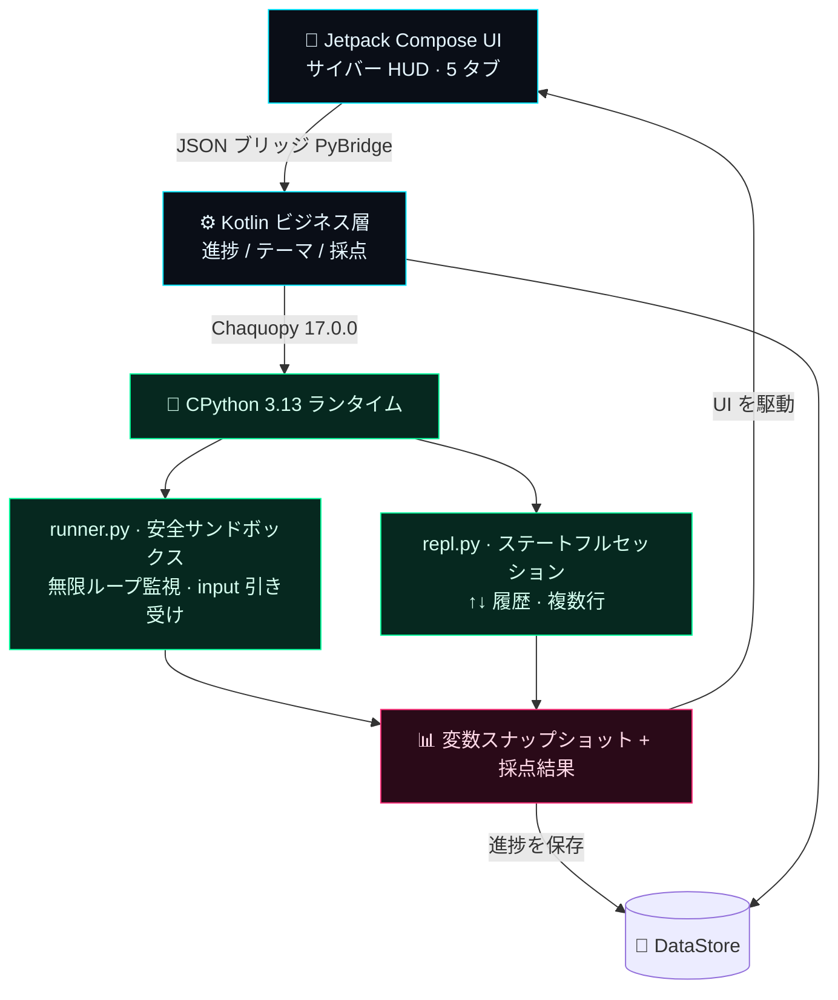
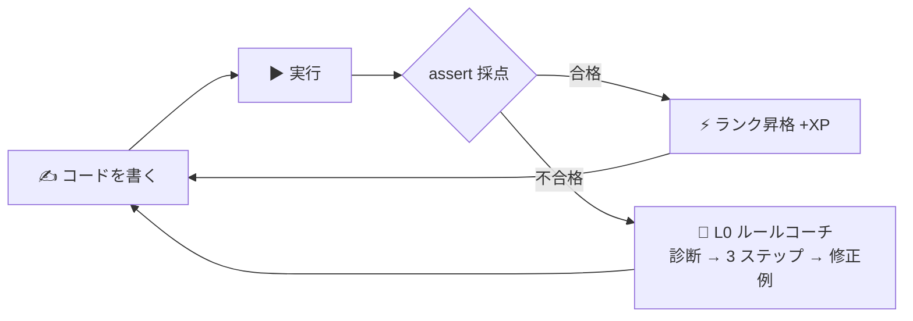

<div align="center">



**今すぐコードを書こう。オフラインのまま、どこでも Python をマスター。**

ポケットに入るサイバーパンク風プログラミング学習ターミナル：**Python / JavaScript / Lua / SQL** の実行環境を内蔵、
38 講のステップアップ講座＋29 講の拡張パック、assert 自動採点、変数可視化、6 段階ランク成長システム。

[](https://github.com/badhope/mashang/actions)
[](LICENSE)
[]()
[]()
[]()
[](#-カリキュラム38-講--5-幕)
[](https://badhope.github.io/mashang/)

🌐 [English](README.md) | [中文](README.zh-CN.md) | [日本語](README.ja-JP.md)

[🎬 予告編](#-予告編50-秒) · [⚡ TL;DR](#-tldr30-秒) · [📊 仕組み](#-なぜオフラインで動くのか) · [📥 ダウンロード](#-ダウンロードとインストール) · [カリキュラム](#-カリキュラム38-講--5-幕) · [⭐ Star](../../stargazers)

</div>

---

## 🎬 予告編 · 50 秒

<p align="center">
  <video src="demo/promo-video.mp4" poster="demo/promo-poster.jpg" controls width="380"></video>
  <br/>
  <a href="demo/promo-video.mp4"></a>
  <br/>
  <sub>▶ ポスターをクリックで再生 · <a href="demo/promo-video.mp4">動画を直接開く</a>（MP4, 1080×1920, 約 50 秒, オリジナルシンセサウンドトラック）</sub>
</p>

> 🌐 [オンラインダウンロードページ](https://badhope.github.io/mashang/) — スマホで開けばスクリーンショット・動画・QR コードからのダウンロード。アカウント不要

## ⚡ TL;DR · 30 秒で分かる

| よくある疑問 | ひとことで |
|---|:--|
| **オフラインで使える？** | ✅ **完全オフライン** — CPython 3.13 を APK に丸ごと内蔵。地下鉄のトンネルでも書いて・動かして・採点まで完結 |
| **本当に「書ける」ようになる？** | ✅ **assert 自動採点** — テストケースを通すまで先に進めない。「わかったつもり」を治す |
| **広告やアカウント登録は？** | ✅ **広告ゼロ · アカウント不要 · データ送信ゼロ**、MIT ライセンス。生徒に安心して勧められる |
| **独自機能は？** | 🔬 **変数スナップショット**（実行後の名前空間を丸ごと可視化）· 6 段階ランク · デイリークエスト · 間隔復習 |
| **学習ボリュームは？** | 📚 **内置 38 講 + 拡張パック 29 講（計 67 講）**：Python 本線に加え JavaScript / Lua / SQL 各 6 講、アリーナ 8 大チャレンジ |

> 🎯 **ひとことで**：空白エディタを渡すアプリではなく、**CPython インタープリター + 採点エンジン + ゲーム的成長**を全部スマホに詰め込んだオフライン学習ターミナル。

## 📊 なぜオフラインで動くのか

他アプリはクラウド実行ゆえに回線が切れると停止。**マシャン** は完全な CPython 3.13 を APK に直接埋め込み、すべてのコードをスマホ本体上で実行します。その実行チェーンがこれ：



> 通信が発生するのは「言語センター」でコースパックを手動取得するときだけ（sha256 検証、個人データは一切送信なし）。学習・コーディング・採点は 100% オフライン。

## 🔁 学習ループ — 書けるまで放さない

「動画を見て忘れる」ではなく、手を動かすことを強制する闭环：書く → 実行 → 採点 → ダメなら指導 → 通ったら昇格。



## 📈 学べる内容 · 6 言語、すべて実実行

どの言語も**本物のランタイム + レッスン + assert 採点**をセットで提供します（文法チートシートではありません）：

| 言語 | ランタイム | 学べること | レッスン |
|---|---|---|---|
| **Python** | 内蔵 CPython 3.13 | print から非同期コルーチン、デコレータ、正規表現、型ヒントまで。2 つの総合プロジェクト付き | 38 講メインライン + DSA 基礎/応用 + 組み込み関数巡り |
| **JavaScript** | Rhino 1.7.15 | console.log、Math、文字列メソッド、分岐ガード、配列ループ、オブジェクト集計 | 6 講スターターパック |
| **TypeScript** | 型消去 + Rhino | 型注釈、interface、関数シグネチャ、ユニオン型の絞り込み、ジェネリクス、enum | 6 講スターターパック |
| **C** | 内蔵インタプリタ（NDK 不要） | printf、int/double/char、for/while、配列、関数と再帰、言語の境界 | 6 講スターターパック |
| **Lua** | LuaJ 3.0.1 | print、local と型、if/for/while、table（配列+辞書）、多値返却、string ライブラリ | 6 講スターターパック |
| **SQL** | SQLite（インメモリ） | SELECT、WHERE/ORDER BY、集計とグループ化、INNER JOIN、INSERT/UPDATE、サブクエリと NULL | 6 講スターターパック |

4 言語とも同じ採点契約：書く → 実行 → assert 判定 → 失敗時はコーチ → 合格で次へ。

- **内蔵とオンデマンド**：Python メインラインは APK に内蔵、起動後すぐ学べます。JS / TS / C / Lua / SQL パックは「言語センター」からオンデマンドでダウンロードし、完了後にレッスン一覧へ表示——初期インストール容量を増やしません。
- **サンドボックスは言語ごとに独立**：Python は `settrace` ウォッチドッグ、JS / TS は `ClassShutter` で Java クラスを全拒否（TS は変換後に JS サンドボックスを共用）、C は自作サブセットインタプリタ（ポインタ/構造体/プリプロセッサ非対応）、Lua は `io`/`os`/`require` を搭載せず、SQL は `:memory:` 固定で `ATTACH` を拒否。
- **未対応**：Java / C++ / Go / Rust はコンパイラやネイティブツールチェーンが必要でオフライン同梱できません。言語センターで「未対応」と明示し、ダウンロード導線も出しません。

## 🏆 6 段階ランク成長

ゲームのようにレベルアップ — 「スクリプトキディ」から「システムアーキテクト」まで：


ランクが上がるごとに新称号 + ネオン実績ウォールが解放。全コース修了で**卒業証書**（ネオン認定ページ、スクショしてシェア）を獲得。

## 📱 真机截图

すべて実機エミュレータ（API 35、1080×2400）の出荷ビルドから撮影。モックアップではありません。

| ホーム | レッスン一覧 | レッスン詳細 |
|:--:|:--:|:--:|
|  |  |  |

| 練習エディタ | 解説ステップと出力 | アリーナ |
|:--:|:--:|:--:|
|  |  |  |

| ターミナル REPL（実行中） | JS ターミナル（Rhino） | プロフィール |
|:--:|:--:|:--:|
|  |  |  |

| チャレンジ詳細 |
|:--:|
|  |

| 判定成功 | 判定失敗 | コースルート |
|:--:|:--:|:--:|
|  |  |  |

| 言語センター | 設定 | JS レッスン |
|:--:|:--:|:--:|
|  |  |  |

> 16 枚のスクリーンショットはすべて v0.4.0 実機（1080×2400、API 35 エミュレータ）撮影：判定成功で +140 XP、失敗パネルは `TestFailed` と最初の失敗ケースを表示、ルート画面は実在するコンテンツのみ、言語センターは HTTPS + SHA-256 で検証します。

## 🎥 Web 版デモ · 28 秒

<p align="center">
  <video src="demo/web-demo.mp4" poster="demo/web-demo-poster.jpg" controls width="640"></video>
  <br/>
  <a href="demo/web-demo.mp4"></a>
  <br/>
  <sub>▶ 実際の Web クライアントで録画（1280×800、Chromium）：講座コード実行、判定合格、XP 保存、REPL 操作。</sub>
</p>

## 🌐 Web 版（ブラウザ）

2 つ目のクライアントは Pyodide 0.29.5（CPython 3.13.2）で**同じ講座 JSON と同じ `runner.py`** をブラウザ内で実行します：

| ホーム | レッスンと判定 | ターミナル |
|:--:|:--:|:--:|
|  |  |  |

- 🔗 オンラインで試す：<https://badhope.github.io/mashang/web/>
- 🧵 実行は Web Worker（15 秒で強制終了、タブは固まらない）、進捗は `localStorage`、hash ルートでリロード復元
- 🧩 範囲：Python 38 講、Python チャレンジ 6 問、REPL 完備。JavaScript チャレンジ 2 問は App 専用


> いずれも出荷ビルドの実際の出力です：`sorted(nums)` → `[1, 1, 2, 3, 4, 5, 6, 9]`、`sum(nums)/len(nums)` → `3.875`、JS タブは Rhino 1.7.15（`10 21`）。練習エディタは未回答時に実際に `NameError` を表示し、ネオンカウンターは 150 XP の仕様です。

## 🎥 使用デモ · 100 秒

<p align="center">
  <video src="demo/usage-video.mp4" poster="demo/app/home.png" controls width="380"></video>
  <br/>
  <a href="demo/usage-video.mp4"></a>
  <br/>
  <sub>▶ クリックで再生 · <a href="demo/usage-video.mp4">動画を直接開く</a>（MP4, 720×1600, 約 100 秒、実機録画）</sub>
</p>

## 👤 こんな人におすすめ

| あなたは | 得られるもの |
|---|---|
| 初学者 / キャリアチェンジャー | `print` からデコレーターまで、38 講の中国語ナラティブ講座（本文は中国語、UI は日本語 README で解説） |
| 通勤・隙間時間学習者 | 完全オフライン、地下鉄のトンネルでもコード実行 |
| 教師 / 保護者 | 広告なし・アカウント不要・データ送信ゼロ、生徒に安心 |
| 開発者 | Compose + Chaquopy の完全リファレンス実装、MIT |

## なぜ Mashang なのか

| | 他のアプリ | Mashang |
|---|---|---|
| コード実行 | ☁️ クラウド依存、回線切れで停止 | 📱 **端末内 CPython 3.13** |
| 教育スタイル | 乾いたドキュメント | サイバーナラティブ + 生活比喩 + 随時クイズ |
| 実行フィードバック | 黒い画面の print | **変数スナップショットパネル** + 結果即時表示 |
| 成長モチベーション | チェックインカレンダー | **XP / 6 段階 / デイリークエスト / 実績ウォール** |

## ✨ 特徴一覧

### 🧠 学習ループ — 書けるまで

- ✅ **assert 自動採点** — テストケース合格でクリア。「わかったつもり」を防ぐ
- ✍️ **穴埋め + 🧩 コード並べ替え** — Mimo 対標の低障壁問題：欠落部分だけ入力 / バラバラの行を正しいプログラムに並べ替え
- 🧭 **L0 ルールコーチ** — エラー即指導：オフラインルールエンジンが「診断 → 3 ステップ → 修正例」を提示。答えは書かない
- 📖 **間違いノート + 間隔復習** — ミスは自動収集、当日/1 日/3 日/7 日…の間隔で復習
- 🧭 **手取り足取りガイド** — 毎講標準：生活比喩 → ASCII 図解 → TASK フォロー → PRACTICE 実践 → STEPS 思考カード

### 🔥 エンジン — オフラインで動く

- 🔌 **完全オフライン CPython 3.13** — Chaquopy 内蔵の本物インタープリター。通信は言語センターのコースパック取得のみ（sha256 検証、個人データなし）
- 🛡 **安全サンドボックス** — 無限ループ監視の強制中断、`input()` の入力キュー引き受け、例外の親切な中国語化
- 🎹 **コードエディタ** — Python 構文ネオンハイライト、スマートインデント（`:` で自動一段）、Tab 補完
- 🖥 **神経インターフェース REPL** — ステートフルセッション、↑↓ 履歴、複数行ブロック、ワンタップリセット
- 🔬 **変数スナップショット** — 実行のたびに名前空間内の全変数の名前/型/値を表示

### 🏆 ゲーミフィケーション — ゲームのように学ぶ

- 🏆 **6 段階ランク** — スクリプトキディ → データゴースト → ネット浪人 → サイバーハッカー → ストリートレジェンド → システムアーキテクト
- ⚡ **デイリークエスト / XP / 連続記録** — 毎日ゴールがあり、実行のたびにフィードバック
- 📦 **言語センター** — コースパック方式：組み込み関数巡礼 + DSA 基礎/応用 + JavaScript / Lua / SQL 入門言語パック（計 29 講）、ワンタップでダウンロード
- 🎓 **卒業証書** — 全コース修了でネオン認定ページが解放、スクショしてシェア

### 🧩 エンジニアリング品質

- 🎨 **7 カラーテーマ** — サイバーネオン / ディープスペースグレー / オーロラグリーン / トワイライトパープル / トワイライトオレンジ / ソフトアイケア / ペーパーホワイト、再起動不要の即時切替
- 🔍 **4 段階の文字サイズ** — 設定でコンパクト / 標準 / 快適 / 大を選択。講座本文のみ拡大し、コードブロックは元のサイズを維持（インデント崩れ防止）
- 🎬 **過程の可視化** — ループ変数や再帰スタックをフレーム単位のアニメーションで表示。単步送り・自動再生・変化項目のハイライト
- 🔀 **多言語の並列比較** — 同じ例を 2〜4 言語で並べ、各列をその場で実行して出力を比較
- 🎛 **サイバー / シンプル 2 スタイル** — 配色とモーションを分離。グリッチ揺れ・スキャンライン・ネオン枠が不要なら「設定 → 外観スタイル」でシンプルに切替（静的組版・細枠・角丸カード）。配色は自由に組み合わせ可能
- 👓 **可読性ファースト** — 演出は装飾ゾーンのみ；講座本文と採点結果は大きめのサンセリフで直表示
- ⚡ **完全オフライン** — 講座とインタプリタを APK に同梱、アカウント不要。新版は Releases からダウンロードして上書きインストール（アプリ内更新は未実装）

## 📥 ダウンロードとインストール

> ⚡ **最速ルート** → 🌐 [オンラインダウンロードページ](https://badhope.github.io/mashang/)：QR コードをスキャンまたはタップ。予告編・スクショ・インストールガイド付き。
> ⭐ **メインリポジトリ** → [github.com/badhope/mashang](https://github.com/badhope/mashang)（Pages・Releases ミラー）
> 🛰 **Pages ミラー** → [x33834.github.io/mashang](https://x33834.github.io/mashang/) · [morningstar202604.github.io/mashang](https://morningstar202604.github.io/mashang/)
> 📦 **リポジトリ（並列同期、どれでも）** → [GitHub/badhope](https://github.com/badhope/mashang) · [GitHub/x33834](https://github.com/x33834/mashang) · [GitCode](https://gitcode.com/badhope/mashang) · [Gitee](https://gitee.com/badhope/mashang)

> Android 7.0+（minSdk 24）、arm64-v8a（64bit ARM 実機向け）。Release ビルドは R8 難読化済み。

- ⭐ おすすめ：[GitHub Releases](https://github.com/badhope/mashang/releases/latest) から最新の `mashang-*.apk` をダウンロード
- 自分でビルド：

```bash
./gradlew :app:assembleDebug        # Debug ビルド
./gradlew :app:assembleRelease     # signed APK via KEYSTORE_PATH / KEYSTORE_PASSWORD / KEY_ALIAS / KEY_PASSWORD
python tests/test_engine_desktop.py   # エンジン単体テスト
python tests/validate_content.py      # 講座 × 解答キー全量検証
```

## ❓ FAQ

**Q: 本当に完全オフライン？ネットワーク権限は何に使うの？**
学習・コーディング・採点は 100% オフライン。通信は「言語センター」でコースパックを手動チェック/ダウンロードするときだけで、個人データは一切送信されません。

**Q: Pydroid3 などの IDE と何が違う？**
Pydroid は開発ツール。私たちは「講座即コード」の学習ターミナル — 各講に採点チャレンジと成長システムが付属。目標は**教えること**で、空白エディタを渡すことではありません。

**Q: iOS 版は出ますか？**
技術スタック（Chaquopy）は Android のみ対応。iOS は別方式が必要で、長期ロードマップで検討中です。

**Q: 講座内容を商用利用できる？**
はい。**MIT ライセンス**で公開 — ライセンス表示を残せば自由に利用・改変・配布（商用含む）できます。詳細は [LICENSE](LICENSE)。

## 📚 カリキュラム（38 講 · 5 幕）

<details open>
<summary><b>第一幕 · 基礎プロトコル</b>（クリックで折りたたみ）</summary>

`01 最初の握手` · `02 変数とデータ型` · `03 文字列アクション` · `04 数値演算プロトコル` · `05 入力信号` · `06 条件分岐マトリックス` · `07 ループエンジン` · `08 リスト倉庫` · `09 辞書キーボールト` · `10 基礎編卒業式`

</details>

<details>
<summary><b>第二幕 · 進化装備</b></summary>

`11 文字列百宝箱` · `12 タプルと集合` · `13 関数進化論(*args/**kwargs)` · `14 内包表記の嵐` · `15 例外シールド` · `16 データ永続化(ファイル/JSON)` · `17 モジュール召喚術` · `18 クラスとオブジェクト覚醒`

</details>

<details>
<summary><b>第三幕 · 高階義体</b></summary>

`19 継承と魔法メソッド` · `20 総合プロジェクト·サイバー銀行` · `21 ジェネレーターエンジン` · `22 デコレータースーツ` · `23 lambda 三銃士` · `24 標準ライブラリ実戦(Counter/re)` · `25 時間とランダム宇宙` · `26 卒業プロジェクト·ログアナライザー`

</details>

<details>
<summary><b>第四幕 · 境界の外</b></summary>

`27 リソースマネージャー(with)` · `28 ファイル入出力プロトコル` · `29 カスタム例外` · `30 モジュールとメインガード(__main__)`

</details>

<details>
<summary><b>第五幕 · 実戦投入</b></summary>

`31 正規表現` · `32 型ヒントとデータクラス` · `33 関数型ツールボックス` · `34 並行処理入門` · `35 非同期コルーチン` · `36 コマンドラインツール` · `37 デバッグとテスト` · `38 仮想環境とエンジニアリング`

</details>

<details>
<summary><b>言語拡張パック · 言語センター配信</b></summary>

エッグ講·組み込み関数巡礼（1 講）· DSA 増補（5 講）· DSA 上級（5 講）· JavaScript 入門（6 講、内蔵 JS ランタイムが必要／本バージョンに同梱）
</details>

各講に含まれるもの：**実行可能サンプル + OUTPUT プレビュー + 図解/表 + QUIZ 随時質問 + assert 採点実戦**
さらにアリーナ 8 大チャレンジ（Python 6 + JavaScript 2）：ネオンカウンター / 回文探知器 / パスワード強度ファイアウォール / 括弧ファイアウォール / ランレングス圧縮器 / 在庫管理者 / ネオンカウンター·JS 版 / 括弧ファイアウォール·JS 版。

## 🧱 技術スタック

```
Kotlin + Jetpack Compose (Material3 サイバー Custom Theme)
        │  JSON ブリッジ PyBridge
Chaquopy 17.0.0 ──► CPython 3.13 (runner.py サンドボックス / repl.py セッション)
DataStore 進捗保存 │ Navigation 単 Activity 5 タブ │ 自作構文ハイライター
```

視覚的な実行チェーンは上の [なぜオフラインで動くのか](#-なぜオフラインで動くのか) のアーキテクチャ図を参照。

## 🗺 ロードマップ

- [x] v0.1 MVP：エンジン闭环 + 7 画面 + 採点
- [x] v0.2 コンテンツ大爆発：26 講 + 4 種類の新コンテンツブロック（表/図解/随時問/出力プレビュー）
- [x] v0.2.1 言語センター：オンラインコースパック DL（端末クラウド協調）、初回パック「組み込み関数巡礼」
- [x] v0.3 成果：DSA 増補パック ×2（10 講）、L0 オフラインルールコーチ、間違いノート + 間隔復習、UI 可読性リファイン
- [ ] v0.3 残り：turtle キャンバス · matplotlib チャート出力 · 実行中変数アニメーション
- [x] 多言語ランタイムは main に実装済み（未リリース、次のバージョン番号は未定）：`LanguageRuntime` 抽象化 + JavaScript パック（Rhino バックエンド）+ 言語フィルタ/切替 UI · Web 版パリティ（Pyodide 0.29.5）· CI 整備（GitHub Actions + GitCode Actions）
- [ ] v0.4 端末側 AI チューター（オンライン LLM）· QuickJS バックエンド（ES6+）· タブレット対応
- [ ] v1.0 アプリストア全チャネル リリース

## 🤝 コントリビューション

あらゆる形を歓迎：新しい講座コンテンツ、バグ報告、UI 磨き上げ、多言語翻訳。
Fork → ブランチ作成 → PR 提出；講座コンテンツは `tests/validate_content.py` の解答キーを同期更新し、全件 PASS を確認してください。

## 📄 ライセンス & プライバシー

本リポジトリは **MIT ライセンス** で公開：ライセンス表示を残せば、個人・教育・商用を問わず自由に利用・改変・配布できます。

- ✅ 閲覧・学習・改変・再配布、さらに商用製品の構築も可能。
- ✅ 「現状有姿」で提供、いかなる保証もなし。リスクは自己責任。
- ™ 「Mashang」/「マシャン」の名称とロゴは商標として保持されます。

サードパーティコンポーネント：[Chaquopy](https://github.com/chaquo/chaquopy) (MIT)、Jetpack Compose (Apache-2.0)、[Rhino](https://github.com/mozilla/rhino) (MPL-2.0)、[sora-editor](https://github.com/Rosemoe/sora-editor) (LGPL-2.1)。

**CI/CD**：[GitHub Actions](https://github.com/badhope/mashang/actions)（テスト + lint + debug/release ビルド + APK 検査 + 署名リリース、3 リポジトリへミラー同期）が唯一実際に実行されゲートを強制するパイプラインです。`.gitcode/workflows/ci.yml` は同等ゲートの設定バックアップに過ぎません：GitCode のコード化パイプラインは手動で有効化が必要で、push では自動起動しません（2026-10-24 の実測では全実行が手動トリガーで、Pages 同期/リンク検査の 2 ステップを含んでいませんでした）。

📄 [プライバシーポリシー](PRIVACY_POLICY.md) · [利用規約](TERMS_OF_SERVICE.md)
