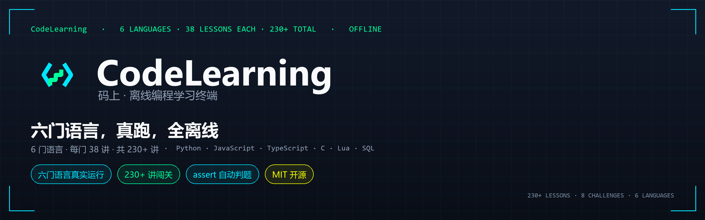

<div align="center">



**CodeLearning · 码上 — write code on your phone. Six languages, 230+ lessons, all offline.**

[](LICENSE)
[]()
[]()
[]()
[](https://github.com/badhope/mashang/releases/latest)

[English](README.md) | [中文](README.zh-CN.md) | [日本語](README.ja-JP.md)

</div>

---

## Screens

| Home | Lessons | Judging |
|:--:|:--:|:--:|
|  |  |  |

| Editor | Terminal | Language Center |
|:--:|:--:|:--:|
|  |  |  |

---

## Six languages, real errors

| Language | Runtime | Lessons |
|---|---|---|
| **Python** | CPython 3.13 | 38 built-in mainline + DSA + builtins |
| **JavaScript** | Rhino 1.7.15 | 38 (basic / core / advanced / expert packs) |
| **TypeScript** | type erasure to Rhino | 38 (basic / core / advanced / expert packs) |
| **C** | built-in interpreter | 38 (basic / core / advanced / expert packs) |
| **Lua** | LuaJ 3.0.1 | 38 (basic / core / advanced / expert packs) |
| **SQL** | SQLite | 30 (basic / core / advanced packs) |

The Python mainline ships inside the APK. The other five download on demand from the Language Center. First install ~39 MB.

C and TypeScript are teaching subsets (C has no preprocessor, `goto` or function pointers; TypeScript has no decorators or namespaces) and say so explicitly when you hit a gap.

---

## Install

- **Just install**: grab `mashang-*.apk` from [GitHub Releases](https://github.com/badhope/mashang/releases/latest)
- Android 10 (API 29)+, arm64-v8a

Build from source:

```bash
./gradlew :app:assembleDebug
```

---

## License

MIT. Third-party licenses are listed in-app under About → Open Source Licenses.

[Privacy](PRIVACY_POLICY.md) · [Terms](TERMS_OF_SERVICE.md)

---

<sub>Mirrors: [GitHub](https://github.com/badhope/mashang) · [GitCode](https://gitcode.com/badhope/mashang) · [Gitee](https://gitee.com/badhope/mashang)</sub>
