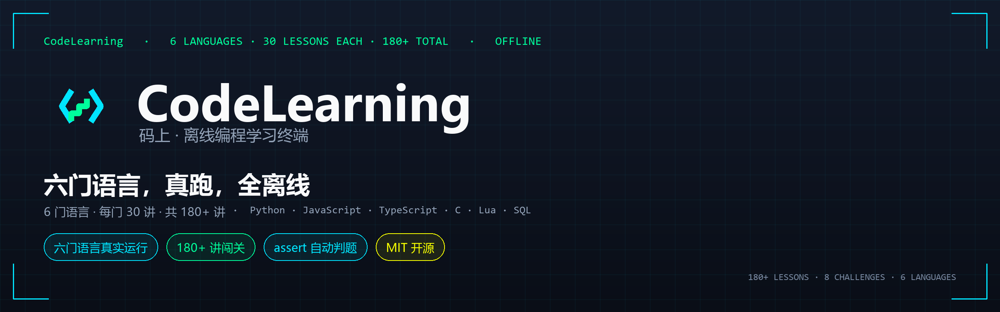

<div align="center">



**码上，就是马上。Six languages, real runtimes, fully offline.**

一台装进口袋的编程学习终端：**六门语言真实执行**（Python / JavaScript / TypeScript / C / Lua / SQL），
79 讲课程、assert 自动判题、过程可视化、赛博与简洁双风格。

[](https://github.com/badhope/mashang/actions)
[](LICENSE)
[]()
[](#六门语言全部真实执行)
[]()
[](https://badhope.github.io/mashang/)

🌐 [English](README.md) | [中文](README.zh-CN.md) | [日本語](README.ja-JP.md)

</div>

---

## 六门语言，全部真实执行

不是语法高亮，不是模拟输出——每门语言都有真实运行时，写错会报错，写对能判题。

| 语言 | 运行时 | 能学到 | 课程 |
|---|---|---|---|
| **Python** | 内嵌 CPython 3.13 | print 到异步协程、装饰器、正则、类型提示 | 38 讲主线 + DSA 算法 + 内置函数 |
| **JavaScript** | Rhino 1.7.15 | console.log、Math、字符串、分支、数组、对象 | 6 讲启程 |
| **TypeScript** | 类型擦除 + Rhino | 类型标注、interface、泛型、联合类型、enum | 6 讲启程 |
| **C** | 内置解释器（无 NDK） | printf、类型、循环、数组、函数递归、语言边界 | 6 讲启程 |
| **Lua** | LuaJ 3.0.1 | local、table、多返回值、string 库 | 6 讲启程 |
| **SQL** | SQLite 内存库 | SELECT、JOIN、聚合、子查询、NULL | 6 讲启程 |

**内置 vs 按需**：Python 主线随 APK 内置，打开即学；其余五门在「语言中心」按需下载，装完才进课程列表——首装不臃肿（约 39 MB）。

**边界诚实**：C 与 TS 是教学子集，不是 gcc / tsc。C 不支持指针、结构体、预处理；TS 不支持装饰器、命名空间。遇到会明确提示，不会给出错误答案。Java / C++ / Go / Rust 需要编译器工具链，无法离线提供，语言中心标注「暂不支持」。

---

## 为什么是码上

| | 别人的 | 码上 |
|---|---|---|
| 代码执行 | ☁️ 云端，断网即瘫 | 📱 **本机真实运行时** |
| 教学风格 | 干瘪文档 | 生活化比喻 + ASCII 图解 + 随堂一问 |
| 运行反馈 | 黑框 print | **变量快照** + 逐帧过程可视化 |
| 多语言 | 各自独立 | **同一套判题契约 + 并排对照** |
| 成长激励 | 打卡日历 | XP / 六段位 / 每日任务 / 成就墙 |

---

## 学习闭环 · 教会你为止

```
写代码 → 运行 → assert 判题 → 不过就辅导 → 通过才升级
```

- **assert 自动判题** —— 用例不过不放行，防「看懂了但不会写」
- **L0 离线教练** —— 报错即诊断，给「三步引导 + 修复示例」，只提示不代写
- **错题本 + 间隔复习** —— 答错自动收录，SM-2 调度（1 天 → 6 天 → 自适应）
- **四种题型** —— 填空、代码排序、随堂问、实战判题

---

## 过程可视化 · 抽象变具体

变量怎么变、循环怎么转、递归栈怎么涨——文字说不清的，一帧一帧看。

```
for 循环求 1+2+3+4+5：
[开始]   i=—   sum=0
[第1轮]  i=1   sum=1    ← 变化项高亮
[第2轮]  i=2   sum=3
...
[结束]   i=6   sum=15
```

支持单步 / 自动播放 / 重置。另有**多语言并排对照**：同一个循环、同一个函数，四种语言写法放一起，每栏都能当场运行对比输出。

---

## 外观可调 · 不止一种审美

赛博朋克是默认个性，但不是唯一选择。

- **双风格** —— 赛博（故障字/扫描线/霓虹描边/切角卡片）与简洁（静态排版/细描边/圆角卡片），在「设置 → 外观风格」一键切换
- **七套配色** —— 赛博霓虹 / 深空灰 / 极光绿 / 暮光紫 / 暮光橙 / 柔光护眼 / 白纸模式，另有自定义主色
- **四档字号** —— 紧凑 / 标准 / 舒适 / 大字，只放大课程正文，代码块保持原样不破坏缩进
- 配色与风格、字号**互相独立**，可任意组合

---

## 技术架构

```
Kotlin + Jetpack Compose
        │  LanguageRuntime 统一契约（JSON 载荷）
PyBridge(Chaquopy) ──► CPython 3.13
JsBridge(Rhino)    ──► JavaScript
TsBridge           ──► 类型擦除后复用 Rhino
CBridge            ──► 教学子集解释器（纯 Kotlin）
LuaBridge(LuaJ)    ──► Lua（无 io/os/require）
SqlBridge(sqlite3) ──► SQL（内存库，拒 ATTACH）
```

**同源保证**：`runner.py` 是唯一判题引擎，Android 走 Chaquopy、网页走 Pyodide 执行同一份源码，测试逐字节校验。新增语言只需实现 `LanguageRuntime` 并注册，UI 零改动。

**沙箱各自独立**：Python 用 `settrace` 看门狗；JS/TS 用 `ClassShutter` 全拒 Java 类；C 无指针/结构体；Lua 不装 `io`/`os`；SQL 固定 `:memory:`。这是学习沙箱，不是安全容器，详见 [SECURITY.md](SECURITY.md)。

---

## 装什么、怎么装

- Android 7.0+（minSdk 24），arm64-v8a
- 下载：[GitHub Releases](https://github.com/badhope/mashang/releases/latest) · [在线下载页](https://badhope.github.io/mashang/)
- 源码构建：

```bash
./gradlew :app:assembleDebug        # Debug APK
./gradlew :app:assembleRelease      # 需 KEYSTORE_PATH 等 4 个环境变量
python -m unittest discover -s tests  # 207 条测试
python tests/validate_content.py     # 79 讲内容全量校验
```

---

## 质量门禁

| 门禁 | 命令 | 证明什么 |
|---|---|---|
| 引擎 + 内容 | `python -m unittest discover -s tests` | 207 条测试：沙箱、超时、判题、并发、内容结构、文档口径 |
| 课程 × 答案 | `python tests/validate_content.py` | 全语言参考答案端到端跑通 |
| 多语言真执行 | 各语言专属测试 | Python/JS/TS/Lua/SQL/C 全部真实执行验证 |
| Android | `./gradlew :app:lintDebug :app:testDebugUnitTest` | 0 lint error + JVM 单测 |
| APK 探针 | `python tests/ci_apk_probe.py <apk>` | APK 内引擎、资产、六语言语法完整 |

---

## 课程体系

**Python 主线 38 讲 · 五幕**

<details>
<summary><b>第一幕 · 基础协议</b></summary>

`01 第一次握手` · `02 变量与数据类型` · `03 字符串行动` · `04 数字运算协议` · `05 输入信号` · `06 条件分支矩阵` · `07 循环引擎` · `08 列表仓库` · `09 字典密钥库` · `10 基础篇毕业式`

</details>

<details>
<summary><b>第二幕 · 进阶装备</b></summary>

`11 字符串百宝箱` · `12 元组与集合` · `13 函数进化论` · `14 推导式风暴` · `15 异常护盾` · `16 数据持久化` · `17 模块召唤术` · `18 类与对象觉醒`

</details>

<details>
<summary><b>第三幕 · 高阶义体</b></summary>

`19 继承与魔法方法` · `20 综合项目·赛博银行` · `21 生成器引擎` · `22 装饰器战衣` · `23 lambda三剑客` · `24 标准库实战` · `25 时间与随机宇宙` · `26 毕业项目·日志分析器`

</details>

<details>
<summary><b>第四幕 · 边界之外</b></summary>

`27 资源管家with` · `28 文件读写协议` · `29 自定义异常` · `30 模块与主守卫`

</details>

<details>
<summary><b>第五幕 · 生产实战</b></summary>

`31 正则表达式` · `32 类型提示与数据类` · `33 函数式工具箱` · `34 并发初探` · `35 异步协程` · `36 命令行工具箱` · `37 调试与测试` · `38 虚拟环境与工程化`

</details>

**语言包**：JavaScript / TypeScript / C / Lua / SQL 各 6 讲 · DSA 基础/进阶各 5 讲 · 内置函数巡礼 1 讲 · 角斗场 8 大挑战

---

## 适合谁

| 你是 | 你会得到 |
|---|---|
| 零基础学生 / 转行者 | 38 讲中文剧情课，从 print 打到装饰器 |
| 想学多门语言的人 | 六门语言同一套判题与成长体系，可横向对照 |
| 通勤碎片时间学习者 | 全离线，地铁隧道里也能跑代码 |
| 教师 / 家长 | 无广告、无账号、零数据上传 |
| 开发者 | Compose + 六运行时完整参考实现，MIT 开源 |

---

## Roadmap

- [x] v0.5 多语言扩容：Lua + SQL 运行时 + 语言中心
- [x] v0.6 六门语言：TypeScript + C、双风格、四档字号、过程可视化、多语言对照
- [ ] v0.7 turtle 海龟画布 · matplotlib 图表输出 · 平板适配
- [ ] v1.0 应用商店全渠道上架

**明确不做**：云端执行（与离线定位冲突）、账号体系（引入数据收集）、内容付费墙（MIT 开源）。

---

## 参与贡献

Fork → 新建分支 → 提交 PR。课程内容请同步更新 `tests/validate_content.py` 的参考答案并保证全部 PASS。

## 许可

**MIT** —— 可自由使用、修改、分发（含商用），保留许可声明即可。"码上" / "Mashang" 名称为保留商标。

第三方：[Chaquopy](https://github.com/chaquo/chaquopy) (MIT) · [Rhino](https://github.com/mozilla/rhino) (MPL-2.0) · [sora-editor](https://github.com/Rosemoe/sora-editor) (LGPL-2.1) · Compose (Apache-2.0) · LuaJ (MIT)

📄 [隐私政策](PRIVACY_POLICY.md) · [用户协议](TERMS_OF_SERVICE.md) · [安全策略](SECURITY.md)

---

## 镜像与分发

源码并列同步至 [GitHub/badhope](https://github.com/badhope/mashang) · [GitCode](https://gitcode.com/badhope/mashang) · [Gitee](https://gitee.com/badhope/mashang) · [GitHub/x33834](https://github.com/x33834/mashang) · [GitHub/Morningstar202604](https://github.com/Morningstar202604/mashang)。

> CI 与发布门禁只在 GitHub Actions 实跑；GitCode 的代码化流水线需手动开通，push 不自动触发。
